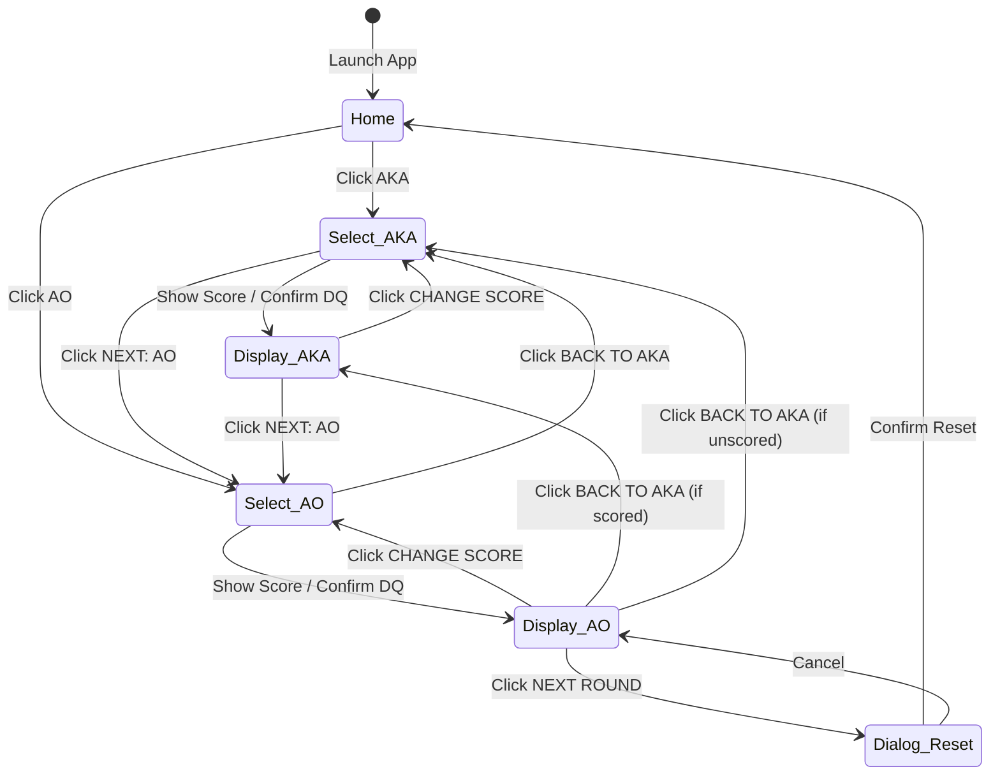

# KATA SCORER — Architecture Documentation

This document describes the software architecture, technical design, state management, and data handling of the **KATA SCORER** application.

---

## 1. Overview

**KATA SCORER** is an unofficial, zero-dependency single-page web application (SPA) created for karate kata competition judges (includes disclaimer: *"Not officially endorsed by the World Karate Federation (WKF)"*).

The application allows judges to select and display scores ranging from **5.0 to 10.0** (in 0.1 increments) or mark a competitor as **Disqualified (0.0)** for two competitor sides: **AKA** (Red) and **AO** (Blue).

### Key Architectural Characteristics
- **Single-File Architecture**: The entire application (markup, styles, and logic) is contained within a single `index.html` file.
- **Zero-Dependency**: No external frameworks, libraries, build tools, package managers, or remote CDNs.
- **Client-Side & Offline-First**: Operates 100% in the user's web browser, functioning offline over standard HTTP/HTTPS hosting or directly from the local filesystem via the `file://` protocol with zero network calls.

---

## 2. Technology Stack

| Layer | Technology | Details |
| :--- | :--- | :--- |
| **Markup** | HTML5 | Semantic structure, ARIA roles (`role="main"`, `role="listbox"`, `role="option"`, `role="dialog"`, `role="status"`), `aria-modal="true"`, and ARIA live regions (`aria-live="polite"` on scores/labels, `aria-live="assertive"` on `#disp-dq-text`). |
| **Styling** | Vanilla CSS3 | Embedded `<style>` tag; CSS custom properties for design tokens (`--bg`, `--surface`, `--aka`, `--ao`, `--dq`, etc.); CSS Grid (5-row named grid in `#screen-display`); Flexbox; CSS Scroll Snap (`scroll-snap-type: y mandatory`); fluid sizing with `clamp()` and `min()`; safe-area insets (`env(safe-area-inset-*)`). |
| **Fonts** | Native System Fonts | UI text uses `'Segoe UI', system-ui, -apple-system, sans-serif`. Score displays use monospace stack `'Courier New', Courier, monospace`. Zero external web font downloads. |
| **Logic** | Vanilla JavaScript (ES6+) | Embedded `<script>` tag running in strict mode (`'use strict'`). No compilers, bundlers, or transpilers required. |
| **Browser APIs** | Native Web APIs | - **Fullscreen API**: Prefixed fallbacks (`requestFullscreen` / `webkitRequestFullscreen`), toggled via `#btn-fullscreen`.<br>- **Screen Orientation API**: `screen.orientation` inspection and `lock()` / `unlock()`, with fallbacks to `matchMedia('(orientation: portrait)')` and `orientationchange`.<br>- **Screen Wake Lock API**: `navigator.wakeLock.request('screen')` with auto-reacquisition on `visibilitychange`. Wrapped in `try/catch` for graceful degradation in unsupported or non-secure contexts. |

---

## 3. Application Structure

The application's DOM is organized into three primary screen views, two overlay elements, and a static disclaimer:

```
index.html
├── Screen Views (Toggled via .active class)
│   ├── #screen-home          (Home screen: AKA and AO initial selection)
│   ├── #screen-select        (Score Selection screen: scroll picker, +/-, DQ, Show Score)
│   └── #screen-display       (Arena Display screen: 5-row named grid for score presentation)
├── Global Overlays & Modals
│   ├── #dialog-overlay       (Promise-based confirmation modal for DQ and Next Round)
│   └── #orient-toast         (Floating toast for orientation adjustments)
└── Footer
    └── .disclaimer           (Non-endorsement notice)
```

### Screen Management
- Screen switching is managed using CSS display classes rather than a router.
- The `showScreen(name)` helper function hides all screens by removing the `.active` class and activates the target screen (`#screen-home`, `#screen-select`, or `#screen-display`).

### DOM Element Caching & Dynamic Construction
- A helper function `$` wraps `document.getElementById()`.
- Screen elements are mapped in `screens = { home, select, display }`.
- Frequently accessed interactive elements are cached at initialization in `els`, storing **25 DOM references** (titles, buttons, displays, dialog components, and orientation toast controls) to eliminate repetitive DOM queries.
- Home screen buttons (`#btn-home-aka`, `#btn-home-ao`) are bound directly via `$()`.
- The 51 score items (`.score-item`) in `#score-scroll` are dynamically constructed at runtime via `buildScrollList()`.

### Orientation Subsystem
- The application defaults to landscape layout (preferred for competition score visibility).
- `isPortrait()` determines device orientation using the Screen Orientation API or `matchMedia`.
- When an orientation mismatch occurs, `#orient-toast` displays a mode-specific prompt (`initial-portrait`, `to-portrait`, `to-landscape`), auto-dismissing after 6 seconds or upon manual dismissal.
- Accepting portrait mode executes `applyPortraitMode(true)`, toggling `.portrait-mode` on `document.body` and triggering `applyScrollPadding()` to recalculate vertical centering for the scroll picker.

---

## 4. State Management

The application uses a single, centralized in-memory JavaScript object as the source of truth for runtime state:

```javascript
const state = {
  competitor: COMPETITORS.AKA,             // Currently active competitor: 'AKA' | 'AO'
  selScore: SCORE_MIN,                     // Currently selected score in picker: 5.0 to 10.0
  displayedScore: { AKA: null, AO: null }, // Confirmed displayed score for each competitor
  displayedDQ:    { AKA: false, AO: false },// Disqualification flag for each competitor
};
```

### Static Constants
- `SCORE_MIN = 5.0`, `SCORE_MAX = 10.0`, `SCORE_STEP = 0.1`, `SCORE_DQ = 0.0`.
- `COMPETITORS = { AKA: 'AKA', AO: 'AO' }`.
- `SCORES`: Pre-calculated array of 51 numbers (`[5.0, 5.1, ..., 9.9, 10.0]`).

### State Flow & DOM Synchronization
State updates follow a clean, predictable unidirectional pattern:
1. **User Interaction**: User clicks a button (`+`, `−`, "SHOW SCORE"), scrolls the picker, or presses a keyboard shortcut.
2. **State Mutation**: The event handler updates `state` (e.g., `state.selScore`, `state.displayedScore[competitor]`, `state.displayedDQ[competitor]`).
3. **DOM Update**: The function explicitly updates the affected DOM elements:
   - `selectByIndex()` updates `#current-score-display`, assigns active classes, and synchronizes `#score-scroll` scroll position.
   - `openSelect()` updates headers, button color classes, pre-populates previous scores, and toggles navigation buttons.
   - `openDisplay()` applies background tints (`.tint-aka`, `.tint-ao`, `.tint-dq`), updates `#disp-label`, `#disp-dq-text`, and `#disp-score`, and configures arena navigation.

---

## 5. Data Storage & Lifecycle

- **Strictly In-Memory (Ephemeral)**: All scores and match state exist exclusively in JavaScript memory (`state` object).
- **No Local Persistence**: The application does **not** use `localStorage`, `sessionStorage`, `IndexedDB`, or cookies.
- **No Remote Backend**: There is no database, backend server, or cloud storage integration.
- **Data Lifecycle**:
  - Scores persist in memory across screen transitions within the current session (e.g., switching between AKA and AO or changing a score).
  - Scores are cleared when the judge completes a match and confirms **NEXT ROUND ↻** in the confirmation dialog.
  - Refreshing or closing the browser tab immediately resets the application to its initial blank state.

---

## 6. Navigation & Screen Flow

The application follows a guarded state machine flow designed to prevent accidental score loss during a tournament:



### Navigation Safeguards
1. **No Accidental Exit**: Neither the Selection Screen nor AKA's Display Screen provides a button to return to the Home screen.
2. **Protected Destructive Actions**: Both Disqualification (0.0) and Next Round (resetting all scores) trigger `#dialog-overlay`, a promise-based modal dialog requiring explicit user confirmation. Clicking the dark backdrop overlay (`e.target === els.dialogOverlay`) safely cancels the dialog.
3. **Smart Re-entry**: Tapping "CHANGE SCORE" reopens the Selection screen with the previously chosen score pre-selected (or 5.0 if the competitor was disqualified, since 0.0 is not in the scrollable 5.0–10.0 list).

### Keyboard Interaction Architecture
Keyboard events are bound globally to `document` and strictly scoped by context:
- **When Dialog Overlay is Active**:
  - `Enter`: Confirms action (`closeDialog(true)`).
  - `Escape`: Cancels action (`closeDialog(false)`).
- **When Selection Screen is Active**:
  - `ArrowDown`: Increments score by 0.1 (moves down the list towards 10.0); invokes `e.preventDefault()` to prevent page scrolling.
  - `ArrowUp`: Decrements score by 0.1 (moves up the list towards 5.0); invokes `e.preventDefault()`.
  - `Enter`: Displays score (`#btn-show`).
- **Home and Display Screens**: Do not listen to keyboard shortcuts.

---

## 7. External Dependencies

KATA SCORER has **zero external dependencies**:

- **No Package Manager**: No `package.json`, `node_modules`, npm, or yarn.
- **No Build Tools**: No Webpack, Vite, Rollup, Parcel, or Babel.
- **No External Libraries**: No React, Vue, jQuery, Tailwind CSS, or Bootstrap.
- **No Third-Party Network Requests**: No external CDNs, Google Fonts, or icon libraries. All icons use standard Unicode symbols (`+`, `−`, `⛶`, `→`, `←`, `↻`, `✕`).
- **Offline Compatibility**: Runs seamlessly without an internet connection, ensuring total reliability in sports venues with poor or no connectivity.
